<p align="center">
  <a href="https://github.com/wisrovi/wpipe-mcp"></a>
  <a href="https://linkedin.com/in/wisrovi-rodriguez"></a>
  <a href="https://wisrovi.dev"></a>
  <a href="https://orcid.org/0009-0005-0710-1861"></a>
  <a href="https://opensource.org/licenses/MIT"></a>
</p>

# 🦅 WPipe-MCP — Agentic Architecture & Orchestration Hub

[](https://pypi.org/project/wpipe-mcp/)
[](https://pypi.org/project/wpipe-mcp/)
[](https://github.com/wisrovi/wpipe-mcp)
[](LICENSE)
[](https://modelcontextprotocol.io)

**Transform your AI Agents into expert WPipe Architects.**

`wpipe-mcp` is a production-grade Model Context Protocol (MCP) server that empowers AI Coding Agents (**OpenCode**, **Gemini CLI / Antigravity CLI**, **Cursor**, **Claude Desktop**) to design, refactor, validate, test, document, and optimize high-throughput pipeline architectures using the **WPipe** standard.

---

## 🏗️ Architecture & Agent Flow

```mermaid
flowchart LR
    subgraph Clients ["AI Coding Agents & IDEs"]
        OC["OpenCode"]
        AGY["Antigravity / Gemini CLI"]
        CUR["Cursor IDE"]
        CL["Claude Desktop"]
    end

    subgraph MCP ["wpipe-mcp Server (stdio / SSE)"]
        direction TB
        Catalog["Catalog & Blueprints Engine"]
        Scaffold["Scaffolding & Monolith Refactoring"]
        QA["Strict QA & Compliance Validator"]
        Optimizer["Static Context Flow & Optimizer"]
    end

    subgraph Targets ["WPipe Pipelines & Microservices"]
        DTO["dto/ (Pydantic Contexts)"]
        STATES["states/ (@step Callables)"]
        PIPE["pipelines.py (Declarative DAG)"]
        MAIN["main.py (Runtime Entrypoint)"]
    end

    Clients -->|MCP JSON-RPC| MCP
    MCP -->|Enforces Standards| Targets
```



---

## ✨ Key Features

- **🔍 Expert Catalog Search (`search_wpipe_step`)**: Search 100+ production-ready pipeline steps across official and community catalogs.
- **🏗️ Strict Architecture Enforcement (`get_wpipe_architect_manual`)**: Directs AI agents to follow modular folder separation: `dto/` for Pydantic Context models, `states/` for atomic `@step` components, `pipelines.py` for declarative DAG assembly, and `main.py` for runtime entrypoints.
- **🚀 Declarative Pipeline Definition (`app/pipelines.py`)**: Dedicated specification and blueprint for standalone pipeline assembly with inline step instantiation (`set_steps([MyStep(), ...])`) and typed execution helper wrappers.
- **🛡️ Automated QA Architectural Validation (`validate_wpipe_project`)**: Deep static analysis checking directory structure, `@step` locations, BaseModel placement, 0 dynamic reflection violations, and 0 compiled bytecode artifacts.
- **⚙️ Automated Monolith Refactoring (`refactor_monolith_to_wpipe`)**: Converts procedural monolithic Python scripts into modular class-based WPipe steps (`@step`) and shared Pydantic contexts.
- **📊 Automatic Pipeline Documentation (`document_wpipe_project`)**: Generates comprehensive Mermaid DAG flowcharts, step tables, and technical specifications directly inside the project's root `README.md`.
- **🧪 Unit Test Generation (`generate_wpipe_tests`)**: Scaffolds isolated `pytest` test suites with extensive English docstrings and mocked execution contexts.
- **🔍 Static Context Data Flow Analysis (`validate_context_flow`)**: Statically validates data contracts and catches missing keys or type mismatches passed between pipeline steps.
- **⚙️ Pipeline Dry Run Simulation (`dry_run_pipeline`)**: Simulates step transitions to verify context mutation order without calling heavy AI models, databases, or external APIs.
- **⚡ Performance & Monitoring Optimization (`optimize_wpipe_pipeline`)**: Statically computes pipeline compliance scores and outputs actionable optimization advice for timeouts, memory profiling, and concurrency.
- **🏆 Enforced WPipe Quality Rules**: Strict standards for English-only code/docs, Google-style docstrings, `mypy` typing, Pylint >= 9.3, Dockerized tests with >80% coverage, Black/Isort formatting, zero dynamic reflection, and zero bytecode artifacts.

---

## 🏆 WPipe QA Compliance Rules

When implementing or validating WPipe pipelines, `wpipe-mcp` strictly enforces the following **13 Mandatory Quality Rules**:

| Rule # | Requirement | Description |
|:---:|:---|:---|
| **1** | **Strict English Policy (100% English)** | All code, docstrings, variable names, functions, classes, comments, log messages, error messages, test names, and UI elements (Gradio tabs, buttons, labels, FAQs) MUST be strictly in English. |
| **2** | **Exhaustive Google-Style Docstrings** | Every module, class, method, and function MUST contain complete Google-style docstrings explicitly detailing all parameters (`Args:` with types and semantics), return values (`Returns:` with types), and raised exceptions (`Raises:` with trigger conditions). |
| **3** | **Full Typing & Mypy Compliance** | Every function parameter and return type must have explicit type annotations passing `mypy --ignore-missing-imports`. |
| **4** | **Pylint Score >= 9.3** | Code must achieve a static analysis score of at least 9.3/10 in Pylint. |
| **5** | **Dockerized Pytest & Coverage (>80%)** | Unit tests must be placed in `tests/`, executed inside a Docker container via `make pytest` or `run_tests_docker.sh`, and maintain >80% statement coverage. |
| **6** | **Formatting & Preserved Functionality** | Code must pass `black` and `isort` without altering or breaking existing execution entrypoints. |
| **7** | **Zero `hasattr` / `getattr` Usage** | Dynamic reflection with `hasattr()` or `getattr()` is strictly forbidden in WPipe pipelines. Context fields must be typed explicitly using Pydantic models, dataclasses, `vars()`, or explicit dictionary lookups (`dict.get()`). Line-by-line checks in `validate_wpipe_project` flag violations. |
| **8** | **Zero Bytecode Artifacts** | All repositories and microservices must maintain **0 `__pycache__` directories** and **0 `.pyc` compiled files** to prevent stale bytecode bugs and container volume pollution. Always enforce `PYTHONDONTWRITEBYTECODE=1`. |
| **9** | **Maximum 200 Lines Per File** | No source file (.py) should exceed 200 lines of code. Decompose complex logic into focused helper modules in utils/ and dedicated DTOs in dto/ to maintain strict modularity. |
| **10** | **Strict Single Responsibility Principle (SRP)** | Every Python file MUST have one single responsibility. Routers, view layouts, event controller handlers, in-memory data cubes, format loaders, and math algorithms must reside in dedicated, non-overlapping modules. |
| **11** | **Zero Nested Closures in Steps** | Defining inner functions (closures) inside `@step` `__call__` methods is strictly prohibited. Helper algorithms and transformations must be extracted into standalone utility functions in `app/utils/`. |
| **12** | **Mandatory User Inquiry & Decision Protocol** | Agents must NEVER make silent assumptions regarding legacy code retention or cleanup. Always explicitly consult the user before deleting obsolete methods/files, keeping legacy wrappers, or making refactoring tradeoffs. |
| **13** | **Zero Dead Code & Redundancy** | Clean repository hygiene requiring unused functions, dead code blocks, obsolete legacy wrappers, and unused imports to be removed or explicitly brought to the user's attention. Zero duplicate files. |

---

## 🛠️ Key Technologies & Libraries

This package is engineered with the following core technologies:

* **Model Context Protocol (MCP)**: High-speed, typed JSON-RPC communication protocol standardizing AI-to-tool integrations.
* **FastMCP (mcp-sdk-python)**: Lightweight, asynchronous framework for exposing MCP tools, resources, and prompt templates.
* **Pydantic v2**: High-performance data parsing, validation, and schema definitions for pipeline contexts and MCP payloads.
* **Pytest & Pytest-Cov**: Comprehensive test harness with automated statement coverage calculation.
* **Black & Isort**: Deterministic code formatting and import sorting according to PEP 8 standards.
* **Ruff & Codespell**: Ultra-fast linting and spelling verification across codebase and documentation.
* **Docker**: Containerized execution environment for reproducible test suites and production deployments.

---

## 📦 Installation

Install `wpipe-mcp` directly from **PyPI**:

```bash
# Standard installation
pip install wpipe-mcp

# Upgrade to latest release
pip install -U wpipe-mcp
```

Alternatively, install locally in editable mode from source:
```bash
git clone https://github.com/wisrovi/wpipe-mcp.git
cd wpipe-mcp
pip install -e .
```

---

## 🔌 AI Agent & IDE Configuration

`wpipe-mcp` seamlessly integrates into popular AI coding agents and development environments.

### 1. OpenCode

Add `wpipe-mcp` to your global configuration (`~/.opencode/mcp.json`) or your project's local `.opencode/mcp.json`:

```json
{
  "mcpServers": {
    "wpipe-mcp": {
      "command": "python",
      "args": ["-m", "wpipe_mcp.server", "run"]
    }
  }
}
```

*Note: Replace `"python"` with the absolute path of your Python interpreter (e.g. `/home/user/miniconda3/bin/python`) if running in a specific virtual environment.*

---

### 2. Gemini CLI / Antigravity CLI (AGY)

Use the built-in MCP command to register `wpipe-mcp`:

```bash
# Using Antigravity CLI
agy mcp add wpipe-mcp $(which python) -m wpipe_mcp.server run

# Using Gemini CLI
gemini mcp add wpipe-mcp $(which python) -m wpipe_mcp.server run
```

Alternatively, configure it inside `~/.gemini/antigravity-cli/mcp_config.json`:

```json
{
  "mcpServers": {
    "wpipe-mcp": {
      "command": "python",
      "args": ["-m", "wpipe_mcp.server", "run"]
    }
  }
}
```

---

### 3. Cursor IDE

1. Open **Cursor Settings** (`Ctrl+,` or `Cmd+,`).
2. Navigate to **Features** > **MCP**.
3. Click **+ Add New MCP Server**.
4. Configure the server:
   - **Name:** `wpipe-mcp`
   - **Type:** `command`
   - **Command:** `wpipe-mcp` *(or `python -m wpipe_mcp.server run`)*

Or edit `.cursor/mcp.json` directly in your workspace:

```json
{
  "mcpServers": {
    "wpipe-mcp": {
      "command": "wpipe-mcp",
      "args": ["run"]
    }
  }
}
```

---

### 4. Claude Desktop

Add the server to your `claude_desktop_config.json` (located at `~/.config/Claude/claude_desktop_config.json` on Linux, or `%APPDATA%\Claude\claude_desktop_config.json` on Windows):

```json
{
  "mcpServers": {
    "wpipe-mcp": {
      "command": "python",
      "args": ["-m", "wpipe_mcp.server", "run"]
    }
  }
}
```

---

### 5. CLI Dynamic Auto-Configuration

You can automatically detect your active Python environment and print ready-to-use configuration blocks at any time:

```bash
wpipe-mcp config
```

To output the JSON block directly without additional formatting:
```bash
wpipe-mcp config --print
```

---

## 🧰 Available MCP Tools Reference

`wpipe-mcp` provides the following MCP tools for AI Agents:

| Tool Name | Parameters | Purpose |
|:---|:---|:---|
| `get_wpipe_architect_blueprints` | *(none)* | Returns production blueprints for states, declarative `pipelines.py`, and monolith migration examples. |
| `get_wpipe_architect_manual` | *(none)* | Returns the official WPipe Architectural Manual with step-by-step guides and all 13 WPipe Quality Rules. |
| `search_wpipe_step` | `query: str` | Queries the official steps catalog for reusable pre-built steps (e.g., Kafka, Redis, OpenCV, YOLO). |
| `deploy_wpipe_scaffolding` | `target_path: str, project_name: str, pipeline_type: str, include_tests: bool` | Generates a complete WPipe standard project with `dto/`, `states/`, `pipelines.py`, and `main.py`. |
| `validate_wpipe_project` | `project_path: str` | Deep architectural compliance auditor checking directories, step decorators, BaseModel placement, 0 reflection, 0 bytecode, max 200 lines per file, and 0 nested function closures. |
| `refactor_monolith_to_wpipe` | `source_file: str, target_dir: str` | Automatically analyzes and slices monolithic scripts into atomic steps and Pydantic context models. |
| `document_wpipe_project` | `project_path: str` | Generates automated Mermaid flowcharts and documentation directly into the project's `README.md`. |
| `generate_wpipe_tests` | `project_path: str` | Automatically builds a container-ready `pytest` test suite with extensive English comments and mocks. |
| `validate_context_flow` | `project_path: str` | Statically checks data key flow between sequential steps, preventing runtime missing attribute errors. |
| `dry_run_pipeline` | `project_path: str, initial_context: dict` | Simulates pipeline transitions in-memory without invoking heavy downstream dependencies. |
| `optimize_wpipe_pipeline` | `project_path: str` | Analyzes code quality, step granularity, and performance bottlenecks, providing actionable scoring. |

---

## 🧪 Running Tests

Unit tests are written with `pytest`. You can run them using any of the following methods:

### 1. Locally
```bash
PYTHONPATH=src pytest tests/ -v
```

### 2. Inside Docker (Containerized)
```bash
./run_tests_docker.sh
```

### 3. Code Coverage Calculation
```bash
./run_coverage.sh
```
The test suite generates a terminal summary and an HTML report at `htmlcov/index.html`.

---

## 📂 Project Structure

```text
wpipe-mcp/
├── src/
│   └── wpipe_mcp/
│       ├── __init__.py      # Package initialization and exports
│       ├── server.py        # Core MCP tools and JSON-RPC dispatchers
│       ├── catalog.py       # GitHub catalog synchronization & caching
│       └── templates.py     # Boilerplate templates for scaffolding
├── tests/
│   └── test_wpipe_mcp.py    # Complete test suite (25 test cases)
├── pyproject.toml           # PEP 517/621 packaging metadata
├── CHANGELOG.md             # Version history & release notes
├── Makefile                 # Automation recipes (clean, build, publish)
├── run_tests_docker.sh      # Docker test runner
├── run_coverage.sh          # Coverage calculation script
└── README.md                # Comprehensive documentation
```

---

## 📄 License

This project is licensed under the **MIT License** — see the [LICENSE](LICENSE) file for details.

---

## 👤 Author & Official Affiliation

* **William Steve Rodriguez Villamizar (Wisrovi)**
* **Role:** Principal AI Engineer & Applied AI Solutions Architect | Scientific Researcher
* 📧 **Email:** [wisrovi.rodriguez@gmail.com](mailto:wisrovi.rodriguez@gmail.com)
* 🌐 **Official Website:** [wisrovi.dev](https://wisrovi.dev)
* 💼 **LinkedIn:** [wisrovi-rodriguez](https://www.linkedin.com/in/wisrovi-rodriguez/)
* 🆔 **ORCID:** [0009-0005-0710-1861](https://orcid.org/0009-0005-0710-1861)
* 📦 **PyPI:** [pypi.org/user/wisrovi/](https://pypi.org/user/wisrovi/)
* 🐙 **GitHub:** [@wisrovi](https://github.com/wisrovi)
